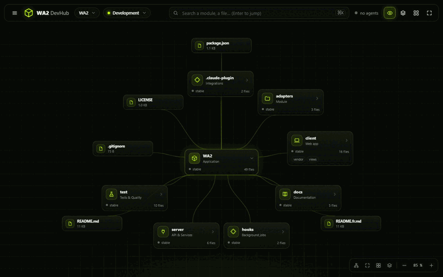

<div align="center">

# WA2 - DevHub

**Watch every AI coding agent at work, live, on an infinite canvas of your repository.**

[](LICENSE)
[](#install-the-claude-code-plugin)
[](#other-ai-tools)
[](https://nodejs.org)
[](package.json)

</div>

DevHub for AI coding agents. Opens an infinite workspace in your browser:
your repository as a living graph (modules, files, functions, dependencies), the agents working on
it in real time, the Git branches with their health, and the app itself while it is being built.
The canvas **is** the interface: no dashboard, floating inspectors only when you select something.



<p align="center">
  <a href="#install-the-claude-code-plugin">Install</a> •
  <a href="#usage">Usage</a> •
  <a href="#what-the-interface-shows">Features</a> •
  <a href="#how-it-works">How it works</a> •
  <a href="#other-ai-tools">Other AI tools</a> •
  <a href="#development">Development</a> •
  <a href="#support">Support</a>
</p>

Works two ways:

- **Claude Code plugin:** one-line install, `/wa2` starts everything, every tool call, subagent and
  task list shows up live.
- **Standalone server (any AI tool):** Codex, Gemini CLI, Cursor, Aider, or any script that can run
  a hook. The adapters in `adapters/` turn their hook payloads into WA2 events, same interface.

Zero server dependencies (Node ≥ 20), zero build step. Three.js (MIT) is vendored in
`client/vendor/three`, so the interface works offline.

## Install the Claude Code plugin

```
claude plugin install wa2 --marketplace 0xyph3r/WA2-DevHub
```

Restart Claude Code (or start a new session), then run `/wa2` in any project.

Prefer the interactive UI? Inside Claude Code, run `/plugin install wa2 --marketplace 0xyph3r/WA2-DevHub`,
answer `y` to add the marketplace, then pick a scope (user is recommended).

<details>
<summary>Other ways to install</summary>

- **Claude desktop app** (no `/plugin` there): click **+** next to the prompt box, then
  **Plugins**, **Add marketplace** with `0xyph3r/WA2-DevHub`, then **Add plugin**.
- **Update:** `claude plugin update wa2`, then `/reload-plugins`.
- **Work on the plugin itself:** `claude --plugin-dir /path/to/wa2`

</details>

## Install with any other AI tool

```
npx github:0xyph3r/WA2-DevHub --repo /path/to/your/project --open
```

Or install it once: `npm install -g github:0xyph3r/WA2-DevHub`, then run `wa2 --repo . --open` in
any project. It also installs `wa2-adapter` (hook bridge for other tools) and `wa2-emit` (send one
event from a script).

<details>
<summary>From source</summary>

```
git clone https://github.com/0xyph3r/WA2-DevHub
node WA2-DevHub/server/index.mjs --repo /path/to/your/project --open
```

</details>

Then plug your tool in through its hooks: see [Other AI tools](#other-ai-tools). Node ≥ 20 is the
only requirement.

## Usage

With the Claude Code plugin, in any project opened with Claude Code:

| Command | Effect |
| --- | --- |
| `/wa2` | starts the WA2 server for the current repository and opens the interface (`http://127.0.0.1:4242`) |
| `/wa2 open` | reopens the interface |
| `/wa2 app http://localhost:3000` | adds the **Live app** node (your application inside an inspector) |
| `/wa2 status` | tells whether the server answers |

With any other tool, start the server by hand (the interface is the same):

```
node server/index.mjs --repo /path/to/your/project --open
```

## What the interface shows

**The infinite canvas** (default view): pan with the mouse, zoom with the wheel, drag nodes,
multi-select (Shift + drag or Shift + click), groups (G), manual links (drag the dot on a node's
edge onto another node), automatic layout (R), fit to view (F), minimap (M). Positions, opened
modules, groups and links are remembered per repository.

- **Modules**: one node per folder, with its type, file count, state (stable / modified … ago /
  N uncommitted files / in progress), the agents present and its subfolders. Click: the module
  opens in place and reveals its content. Click a file: its symbols (functions, classes, exports).
  Click a symbol: its references across the repository; the files involved appear on the canvas.
- **Dependencies**: the real imports (resolved file by file) drawn as dashed accent lines between
  the visible nodes, with the import count; click a line for the list.
- **AI agents**: one node per agent (role, mission, current module, last action in plain words,
  progress, current file), placed next to the module it works on. Every tool call is a pulse that
  travels along the agent → module wire (blue for a read, accent colour for a write, red on error),
  the module lights up, a caption says who does what.
- **Characters**: every agent has a small character on the canvas. On each real tool event it walks
  to the module or file involved, works there (blue for reading, accent for writing), then waits on
  the spot. Nobody moves without an event. Click a character to open its agent inspector. The
  character's colour shows the AI tool (Claude Code, Gemini CLI, Cursor, Codex…).
- **Follow the agents** (eye icon, on by default): when an agent writes a file, the canvas does what
  you would have done by hand: opens the module, reveals the file, selects it and shows its code in
  the inspector. Following pauses for a few seconds as soon as you touch the canvas.
- **Control the agents** (Claude Code sessions): select an agent to **Stop** it, **Resume** it or
  send it a **message**. Stopping the main session aborts its running turn and refuses its next tool
  calls until you type a prompt, send a message or click Resume; stopping a subagent refuses its
  next tool calls and tells it to report. A message goes to the main session as your prompt, or to
  a subagent as a `SendMessage`.
- **Approve on the canvas** (Settings, off by default): hold a tool call until you click **Allow**
  or **Deny** in the tray under the top bar. Two levels: *on collisions* (a write to a file another
  agent is editing) or *always* (every file write and shell command). It only holds calls while the
  page is open, and a call nobody answers runs after 90 s through Claude Code's own permissions.
  The tab title shows how many calls wait for you.
- **Collisions**: two agents writing the same file within 15 minutes raise a red alert (tray, red
  ring on the file or its module, agent inspectors); two agents writing in the same folder within
  5 minutes raise an amber overlap. Dismiss one and it stays quiet until another agent joins it.
- **Git branches**: one node per branch (current, base, ↑/↓ remote tracking, commits not yet in the
  base, modified files, conflicts, agents on it). A branch is only called merged when every commit is
  in the base branch (`main`, `master` or `develop`, per `git branch --merged`). The canvas shows the
  current branch, the base and the most recent ones; the panel lists them all, and opening one from
  there puts it on the canvas.
- **Large repositories**: the same canvas, kept readable.
  - A module card is as wide as its share of the repository, and folders come biggest first.
  - With many siblings, small quiet folders and loose files wait behind one "+ N" card; any agent,
    git change or collision brings them back out on their own.
  - A run of folders holding one folder each (`src/main/java/com`) is a single card.
  - Zoomed out, a module card shows only its name, size and activity (lit when agents work there).
  - Searching or clicking a path reveals it wherever it is. Past 4,000 files the scan keeps every
    folder and drops the deepest files first, and the root card says how many were left out.
  Branches checked out in a **git worktree** say so, and an agent whose session runs inside a
  worktree is attached to that worktree's branch.
- **Branch health**: every branch carries a badge (healthy / watch / problem) computed with git
  alone. Only what breaks a merge or a build is a problem: conflicts against the base branch
  (`git merge-tree`, the working tree is never touched), unresolved conflicts, failed tests or build.
  Being behind the base or the remote, or unmerged work left untouched for 30 days, is something to
  watch. A merged branch is healthy whatever its age. Details live in the branch inspector.
- **Live app**: if `.wa2.json` holds an `app` URL, a node opens your application in an inspector.
- **Contextual inspector**: appears next to what you select (module, file, symbol, agent, branch,
  dependency, group) and closes with Escape. Code, log, commits, tasks, references: real data only.
- **Left panel** (☰ icon or Ctrl+B): navigation (overview, 3D views, modules, agents, tasks,
  branches, tests, live app, settings), project card (state, task progress, host CPU/RAM) and
  collapsible sections: agents, live activity, current file (code), tasks, Git branches with their
  health, build/tests/coverage/latency metrics, project tree. Every click in the panel lands on the
  matching spot of the canvas. Open sections are remembered.
- **Relief 2.5D** (layers button in the bottom-right HUD, or T): the plane holding the world is
  tilted with perspective, cards float above it at a height that depends on their kind, characters
  and captions stand upright, the far edge fades into fog. Pan, zoom, drag and selection stay exact.
- **Themes** (Settings): Lime, Cyan, Amber, Rose, Violet, Monochrome, Light. Applied at once on the
  canvas, on the next load for the 3D views.
- **Exploded view** (layers icon in the top bar): the application split into 3D layers Frontend /
  Backend / Business logic / Database / Integrations / Infrastructure, agents on the left; click a
  layer to isolate it, rotate and zoom with the mouse. **Full 3D architecture** (modules icon): the
  whole repository as a city.

Everything comes from real data: the watched file system, `git`, and the events the plugin sends on
every tool call. Nothing is simulated; an empty panel says so.

## How it works

```
Claude Code ──hooks/register.ts──POST /api/event──▶ server/index.mjs ──SSE /events──▶ client/
Gemini / Cursor / Codex / scripts ──adapters/*.mjs─────┘
                                                      │  fs.watch, git, import scan
                                                      ▼
                                                  your repository
```

- `hooks/register.ts`: Claude Code hooks module. Registers `/wa2`, starts the server
  (`$.process.spawn`), and forwards `tool.call`, `agent.spawn`, `turn.complete` and task lists.
  It also long-polls the server for canvas commands and holds tool calls for approval.
- `server/`: dependency-free Node HTTP server. `tree.mjs` (scan), `deps.mjs` (imports),
  `symbols.mjs` (declarations), `health.mjs` (branch health), `events.mjs` (event shapes),
  `control.mjs` (stop / message commands, approvals, collisions), `index.mjs` (HTTP, SSE, git,
  watcher).
  JSON routes: `/api/tree`, `/api/git`, `/api/deps`, `/api/file`, `/api/symbols?path=`, `/api/refs?q=`,
  `/api/collisions`; control: `POST /api/control`, `GET /api/control/wait` (long poll for the
  hooks module), `POST /api/approval`, `GET /api/approval/wait`, `POST /api/approval/decide`.
- `adapters/`: `normalize.mjs` (other AI tools' hooks → WA2 events, tested), `stdin.mjs`, `emit.mjs`.
- `client/`: HTML/CSS/JS, no build. `views/canvas.js` (infinite canvas, characters, follow mode,
  relief), `inspector.js`, `sidebar.js` (left panel), `views/stack.js` and `views/city.js` (3D,
  Three.js through an import map). `layout.js` is pure and tested under Node.

Per-repository settings live in `.wa2.json` at its root (`name`, `app`, `gate`). Port: `--port` or `WA2_PORT`.
The server only binds `127.0.0.1`, serves files inside the watched repository, and accepts `http(s)`
URLs only for the live app.

## Other AI tools

WA2 is not tied to Claude Code: the server accepts any event on `POST /api/event` and the
`adapters/` folder converts the hooks of other tools. Start the server once
(`node server/index.mjs --repo <folder>`), then plug the tool in:

| Tool | Setting |
|---|---|
| **Gemini CLI** | in `~/.gemini/settings.json`, `BeforeTool` and `AfterTool` hooks (plus `SessionStart`/`SessionEnd`) running `wa2-adapter --from gemini` |
| **Cursor** | in `.cursor/hooks.json`, `afterFileEdit`, `beforeShellExecution`, `beforeReadFile`, `stop` → `wa2-adapter --from cursor` |
| **Codex CLI** | in `~/.codex/config.toml`: `notify = ["wa2-adapter", "--from", "codex"]` (one event per turn) |
| **Anything else** | `wa2-emit --provider aider --tool Edit --file src/app.js`, `--spawn "mission"`, `--done`, `--task "subject" --status in_progress` |
| **Raw** | `curl -X POST http://127.0.0.1:4242/api/event -H 'content-type: application/json' -d '{"type":"tool","tool":"Edit","file":"src/a.js","agent":"main","session":"x","provider":"mytool"}'` |

Running from a clone instead? Replace `wa2-adapter` with `node <WA2>/adapters/stdin.mjs` and
`wa2-emit` with `node <WA2>/adapters/emit.mjs`.

The adapter reads the hook's JSON on stdin (or as an argument), echoes it back untouched on stdout
so it never gets in the tool's way, and maps the tool's own names (`write_file`,
`run_shell_command`, `afterFileEdit`…) onto WA2's canonical set (`Write`, `Bash`, `Edit`…). The
`provider` field colours the character and labels the agent card. Hook formats of other tools
change over time: check the docs of your version if nothing shows up
(`node adapters/stdin.mjs --from gemini < payload.json` to test).

## Development

```
npm test                       # Node tests (layout, scan, imports, events, health, adapters)
claude plugin validate .       # manifest + hooks module
node server/index.mjs --repo . --open
node test/events.post.mjs      # pushes a burst of demo events into the server
node test/shot.mjs http://127.0.0.1:4242/ out.png --post . --eval "<js>"   # screenshot + script through headless Chrome (CDP)
node test/record.mjs http://127.0.0.1:4242 .            # records docs/demo.gif (needs ImageMagick `magick`)
```

## Support

If WA2 helps you, donations welcome:

- **Monero (XMR):** `45aJUjAM63pVsd3QB872kAGDbvGCG4Bs9755qLfo6ikXYQsw2hvpKYHNQXvFzdhGWgGs5QHYLqXijR5Miyqo7s4gAaxm6RT`
- **Solana (SOL):** `5ChmkTVKhbnCCYf7Ss3Q6uxoErqx3ZR7q1QhSFqR4N79`
- **Bitcoin (BTC):** `bc1qmclxs8lmkxvhavz7u6j7jwxw7n7txdexlkuv0j`
- **Ethereum (ETH / EVM):** `0xA6c145D12b7C5623663Db4bCf80B9DA7FD536883`

<div align="center">

## License

MIT - see [LICENSE](LICENSE)

</div>
